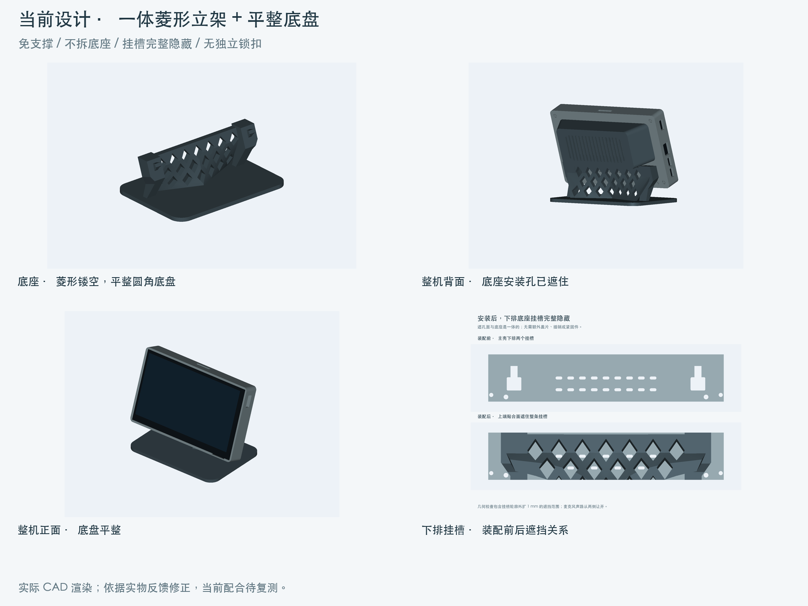
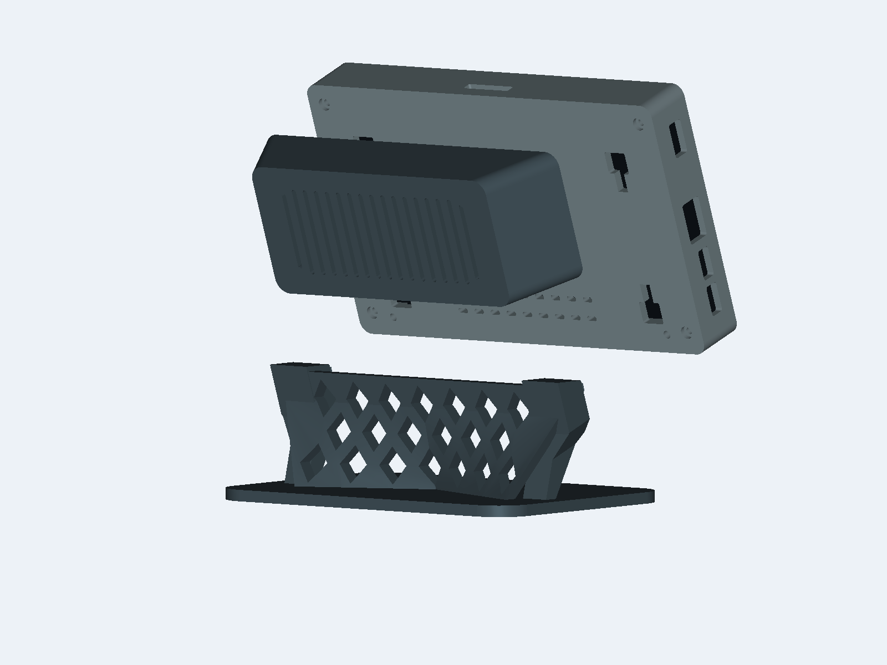
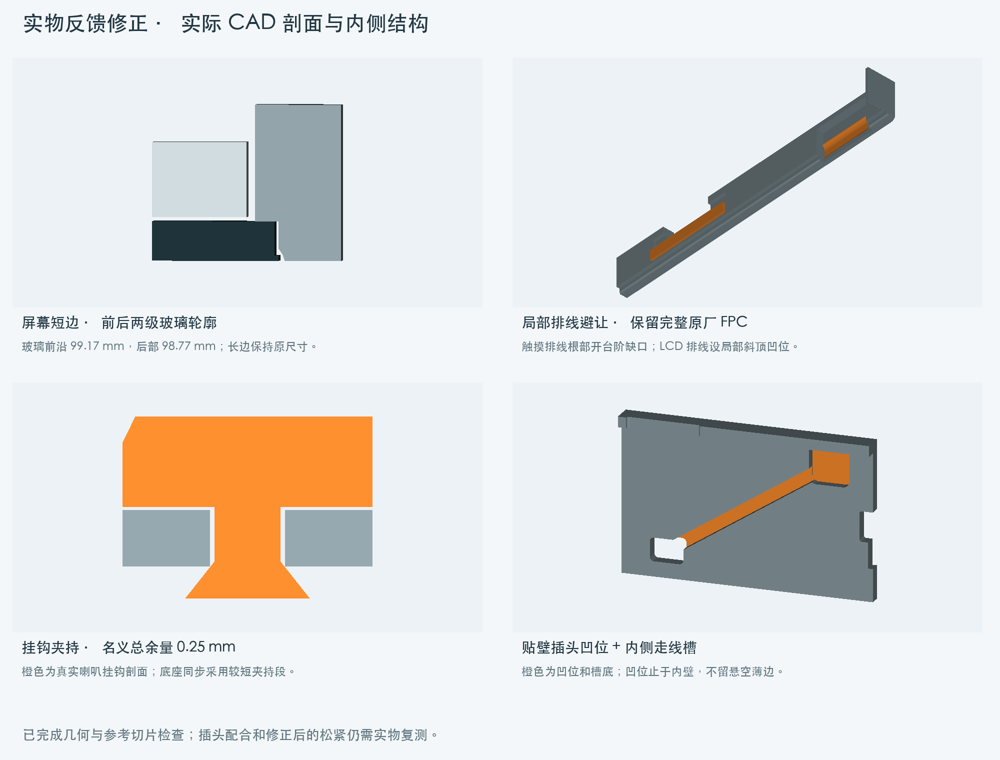

# ESP32-P4 7B 模块化外壳

为 **Waveshare ESP32-P4-WIFI6-Touch-LCD-7B** 设计的 3D 打印外壳：齐平屏幕、一体主壳、外挂喇叭、一体菱形底座，以及供后续模块使用的机械扩展口。

Open-source, CadQuery-based printable enclosure for the Waveshare ESP32-P4-WIFI6-Touch-LCD-7B, with a flush display seat, detachable speaker pod and one-piece lattice desk stand. Dimensions are in millimetres. **Prototype feedback incorporated; corrected dimensions await a physical recheck.**



## 下载与使用

- [自动发布的模型](https://github.com/kuaner/esp32-p4-7b-enclosure/releases/latest)：各零件 STL / STEP、装配、扩展模板和 SHA-256 校验值。
- [打印与装配说明](output/current/README.md)：打印朝向、螺丝、安装顺序和拆卸动作。
- [STL 打印文件](output/current/STL/) / [STEP 可编辑模型](output/current/STEP/) / [装配 STEP](output/current/STEP/assembly.step)。

只保留一套当前设计，后续直接更新。保持 STL 的初始方向、100% 比例，关闭支撑，无需自动摆正。已根据实物反馈修正短边开口、排线避让和挂钩松动，当前配合仍需复测。

| 零件 | 包围尺寸 mm | 打印朝向 | 数量 |
|---|---|---|---:|
| [主壳](output/current/STL/shell.stl) | 171 × 105.17 × 22 | 背面贴床，屏幕口朝上 | 1 |
| [喇叭盒](output/current/STL/speaker.stl) | 145 × 54 × 35.671 | 网孔底贴床，开口朝上 | 1 |
| [底座](output/current/STL/stand.stl) | 146 × 104 × 50.8 | 平整底盘贴床 | 1 |

三件各自是一体件，底座的立架与底盘不拆分。参考切片使用 PETG、0.4 mm 喷嘴、0.20 mm 层高、4 圈墙和 15% gyroid 填充。主壳接口与相机出口包含桥接，需要打印机具备相应桥接能力。

## 结构

- **屏幕齐平落座**：边框与后盖一体，开口侧设台阶；先斜放开关/USB 端，再放下按键端，用原四颗 M2.5 × 8 mm 螺丝固定，无预埋螺母。
- **短边与排线**：按 STEP 的玻璃前沿 99.17 mm、后部 98.77 mm 两级轮廓配合，长边保持原尺寸；触摸排线根部留局部台阶缺口，LCD 排线留斜顶凹位，检查保留完整原厂排线几何。
- **接口外露**：电源、开关、按键、TF 和双麦克风声路保留；顶部预留居中 22 × 4 mm 摄像头排线口，只提供出线空间。
- **外挂喇叭**：按 99.5 × 44.5 × 20.8 mm 的 45100 喇叭设计，一体开口盒、内部挡扣与框边支点限位，可补薄双面胶；背面居中出线，装配后隐藏。
- **模块化挂接**：双插脚贴入宽口后滑动 8 mm 挂住，无独立锁扣。上排挂喇叭，下排翻转用于底座承托；底座安装后完整遮住对应挂槽。
- **夹持与内藏走线**：挂钩按斜肩实际接触位置控制，名义轴向总余量 0.25 mm；主壳内侧有 12 mm 宽的贴壁喇叭插头凹位和 3.8 mm 走线槽，接到居中出线口，槽底保留约 1 mm 外皮。
- **一体菱形底座**：20 个菱形镂空、平整圆角底盘，打印时底盘直接贴床。





向上提主机是拆卸底座的动作，移动整机时需同时托住底座。当前没有防提脱锁定结构。

## 扩展接口

这是本项目的**机械接口**，不包含电气定义。源文件为 [cad/interface.py](cad/interface.py)，提供 [空白扩展模板 STEP](output/current/STEP/expansion_adapter.step)。

| 参数 | mm |
|---|---:|
| 左右挂点中心距 | 125 |
| 上下排中心距 | 48 |
| 宽口 | 10 × 9 |
| 直槽宽 | 4.8 |
| 标准插脚窄根 | 4.2 × 8 |
| 标准宽头 | 8 × 8 |
| 挂接行程 | 8 |

上排模块向下滑入；下排底座固定时，屏幕向下滑入。开发新模块时需匹配承重方向，避让相邻模块、线缆和麦克风声路，并单独检查打印方向。

## 检查状态

| 检查 | 当前结果 | 边界 |
|---|---|---|
| CAD / STL | 三件均为有效单实体、封闭网格、Z 最低点为 0 | 不验证材料强度 |
| 装配 | 92 项通过，含完整排线、两级玻璃、四组挂钩间隙、走线和挂槽遮挡 | 离散位置检查，非连续运动或疲劳仿真 |
| 逐层几何 | 喇叭盒、底座通过 0.20 mm 逐层承托检查 | 不模拟挤出、冷却和变形 |
| 参考切片 | 三件关闭支撑成功，支撑刀路为零，无警告 | Bambu Studio / P1S / Generic PETG 参考配置 |
| 修正后实物复测 | **待完成** | 已有打样反馈；当前缩口、排线避让、挂钩松紧和插头配合需复测 |

详见 [检查报告](output/current/verification/) 和 [打印说明](output/current/README.md)。CI 重新构建模型并检查模块逐层几何；原厂板卡配合检查和 Bambu 切片需在相应本地环境运行。不提供机器专用 G-code。

## 从源码构建

建议使用 Python 3.12。模型构建和逐层检查不需要原厂 STEP；运行脚本会覆盖 `output/current/` 的相应输出。

```sh
git clone https://github.com/kuaner/esp32-p4-7b-enclosure.git
cd esp32-p4-7b-enclosure
python3.12 -m venv .venv
source .venv/bin/activate
python -m pip install -r cad/requirements.txt
python cad/check_release.py
python cad/build_design.py
python cad/check_printability.py
```

Windows 可使用 `.venv\Scripts\activate` 激活环境。Linux 如缺少 OpenGL 库，可安装 `libgl1 libegl1 libopengl0`。完整检查、原厂参考和渲染步骤见 [开发说明](docs/DEVELOPMENT.md)。`cad/parameters.json` 记录当前参数；部分特征直接在 Python 中定义，并非全部由 JSON 驱动。

## 参与与许可

欢迎提交实测反馈、尺寸修正和扩展模块，参见 [CONTRIBUTING.md](CONTRIBUTING.md)。AI 编程助手的项目约束与检查命令在 [AGENTS.md](AGENTS.md)。

推送任意 Git tag 即由 [GitHub Actions](.github/workflows/release.yml) 自动构建并发布模型，Release 标题就是 tag 名。附件直接提供 `shell`、`speaker`、`stand` 的 STL / STEP，以及装配、扩展模板和校验文件。源码使用 GitHub 自带的 Source code 下载入口。具体步骤见 [发布流程](docs/DEVELOPMENT.md#发布流程)。

本项目原创源码、模型及文档采用 [MIT License](LICENSE)。原厂板卡 STEP / DWG / PDF、第三方喇叭图片及本地缓存不随仓库或发布包分发，见 [THIRD_PARTY_NOTICES.md](THIRD_PARTY_NOTICES.md)。本项目独立维护，与 Waveshare 无隶属关系；板卡资料参阅 [Waveshare 官方资源](https://docs.waveshare.com/ESP32-P4-WIFI6-Touch-LCD-7B/Resources-And-Documents)。
