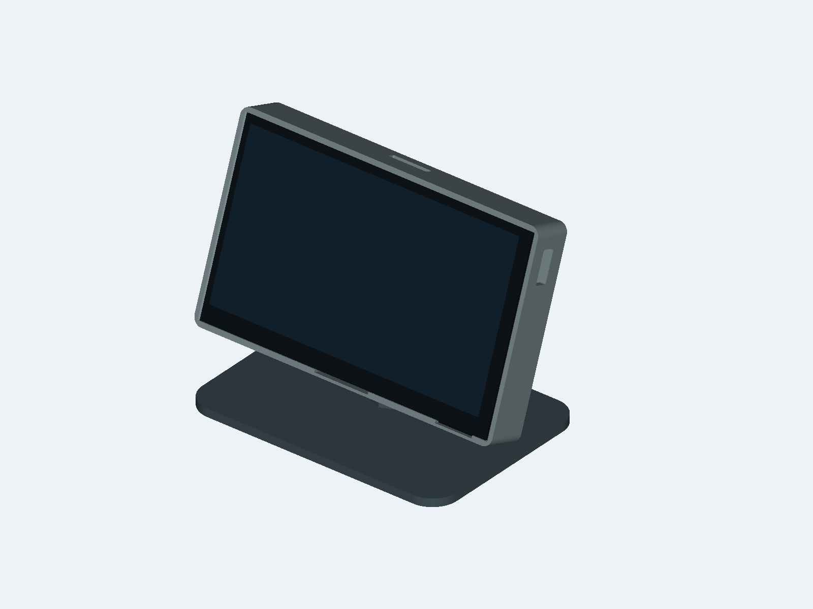
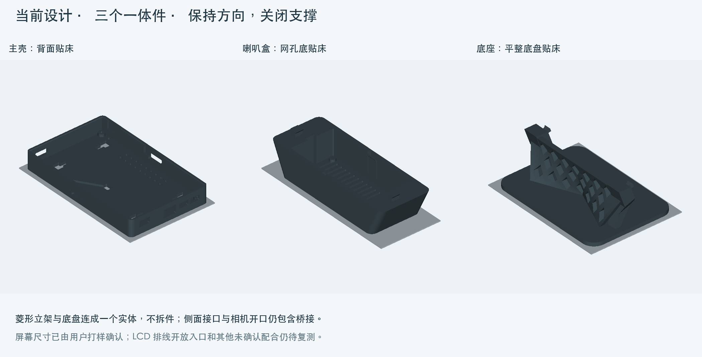
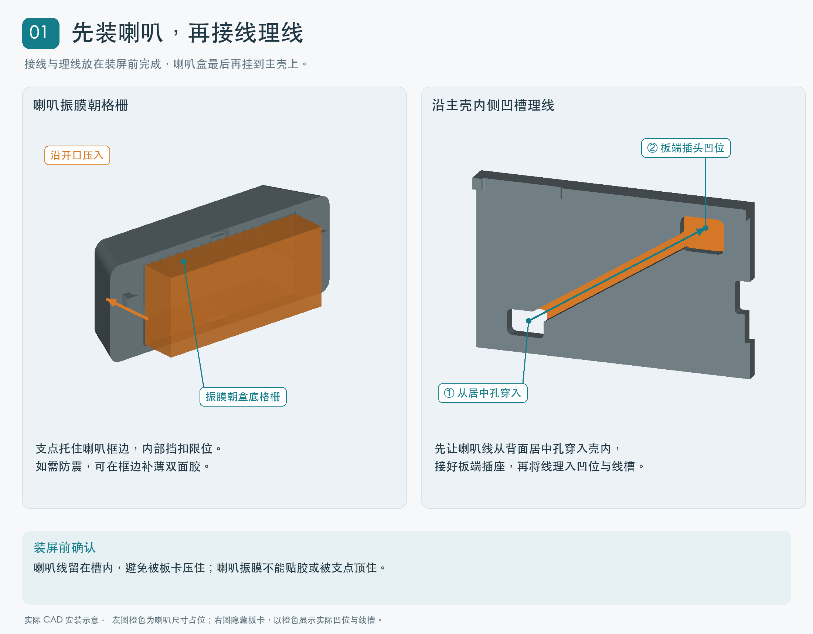
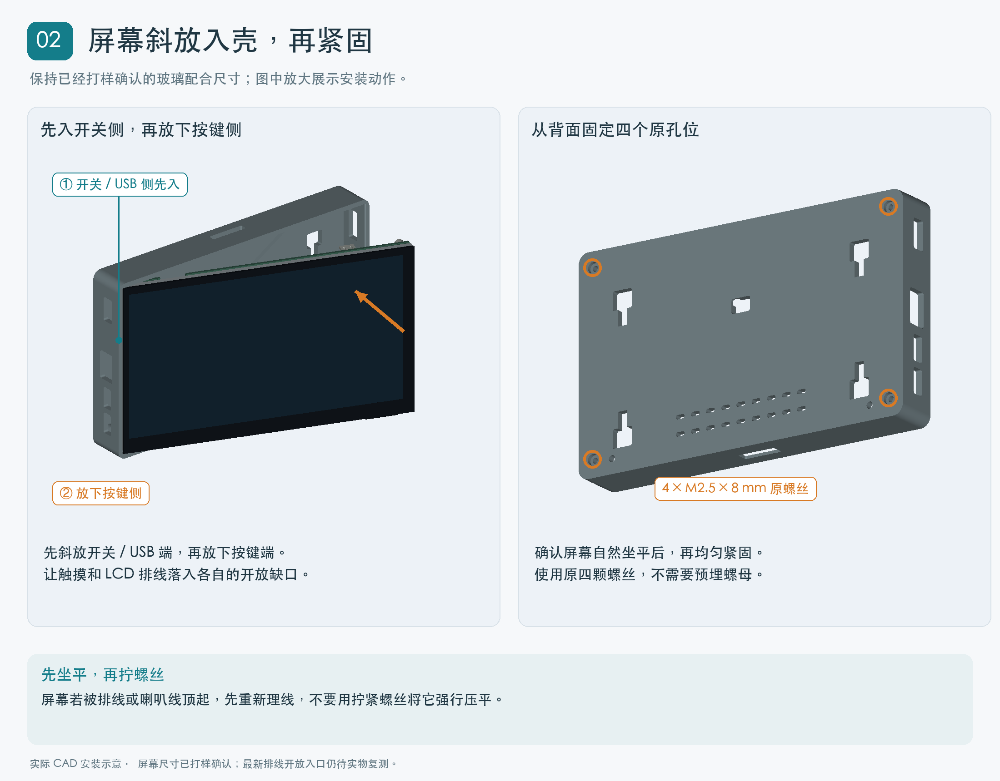
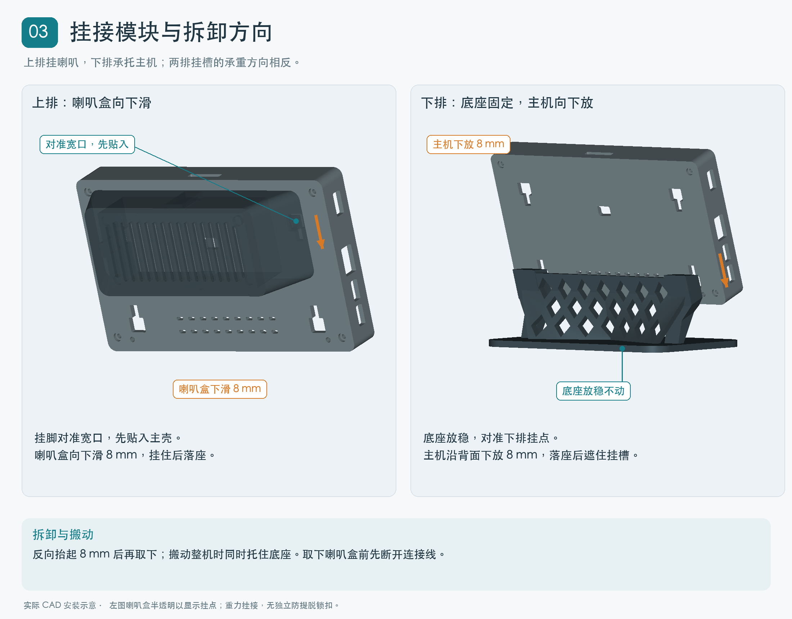

# 微雪 ESP32-P4 7B 7寸屏外壳｜可拆喇叭与菱形桌面底座

已发布：[MakerWorld 模型与打印配置](https://makerworld.com.cn/zh/models/3133971-wei-xue-esp32-p4-7b-7cun-ping-wai-ke-ke-chai-la-ba#profileId-3692652)。以下为图文说明的仓库副本。

为 Waveshare ESP32-P4-WIFI6-Touch-LCD-7B 设计的模块化桌面外壳，包含一体屏幕壳、外挂喇叭盒和菱形底座。适合把开发板整理成一台横屏桌面小终端。

## 设计特点

- **齐平屏幕，一体外壳**：边框与后壳一体，屏幕落在内部台阶上，无需单独的前框。
- **接口正常使用**：保留电源、USB、开关、按键、TF 卡和双麦克风声孔，顶部留有摄像头排线出口。
- **可拆模块**：喇叭盒和底座通过背部重力挂槽安装，滑动 8 mm 即可挂接或拆下，无独立锁扣。
- **隐藏走线**：喇叭线沿壳内凹槽走到居中出线口，装好喇叭盒后隐藏。
- **一体喇叭盒**：带出音格栅、框边支点和内部限位卡扣，不需要单独的盖子；可在喇叭框边补少量薄双面胶防震。
- **一体菱形底座**：菱形立架与平整底盘连成一件，安装后遮住对应挂槽。
- **可继续扩展**：提供通用机械挂接接口及空白 STEP 模板，方便自行设计其他附件。

## 适配范围

屏幕主壳适配 **微雪 ESP32-P4-WIFI6-Touch-LCD-7B**，不代表兼容所有 ESP32-P4 或所有 7 寸屏。

喇叭盒按本项目尺寸图对应的 **45100 喇叭**设计：标称 99.5 × 44.5 × 20.8 mm，最大包络 100 × 45 × 21.1 mm。同名喇叭可能有不同外形，打印前请核对实物。

摄像头仅预留顶部 **22 × 4 mm 排线出口**，不包含相机支架。

## 打印设置

三个零件各打印一件，均按免支撑方向设计。保持 STL 的初始方向和 100% 比例，关闭支撑，不使用自动摆正。

| 文件 | 打印方向 |
|---|---|
| `shell.stl` 主壳 | 背面贴床，屏幕开口朝上 |
| `speaker.stl` 喇叭盒 | 格栅面贴床，开口朝上 |
| `stand.stl` 底座 | 平整底盘贴床，立架与底盘一体打印 |

参考切片参数：**PETG、0.4 mm 喷嘴、0.20 mm 层高、4 圈墙、15% Gyroid 填充**。局部接口包含桥接，请确认自己的打印机具备相应桥接能力。

## 安装方法

### 1. 装喇叭，接线并理入凹槽

将喇叭振膜朝向格栅，从盒子开口装入，由支点与内部卡扣限位。把喇叭线从主壳背面的居中孔穿入，接好板端插座，并沿内侧凹槽理顺。**先完成接线与理线，再装屏幕**，喇叭盒暂不挂到主壳上。

### 2. 屏幕斜放入壳，再锁紧四颗螺丝

先将屏幕的开关 / USB 一侧斜放入主壳，再放下按键一侧，让触摸和 LCD 排线落入各自的开放缺口。确认屏幕自然坐平后，从背面使用原四颗 **M2.5 × 8 mm 螺丝**固定，不使用预埋螺母。不要通过拧紧螺丝压平被排线或喇叭线顶起的屏幕。

### 3. 挂接喇叭盒与底座

喇叭盒对准上排宽口，先贴入，再下滑 **8 mm** 挂住。底座则先放稳，主机对准下排挂点，沿背面下放 **8 mm** 落座。

反向抬起即可拆卸。挂接结构依靠重力落座，**搬动整机时请同时托住底座**；取下喇叭盒前先断开连接线。

## 打样与检查状态

屏幕配合尺寸已通过实物打样确认。最新 LCD 排线避让已去除前端挡边和斜顶，改为直通屏幕面的开放缺口，并完成 CAD 入口检查及参考切片；这次入口修正和其他尚未确认的配合仍待实物复测。

## 开源

GitHub 仓库中的原创模型、源码和文档采用 **MIT 许可**，提供 STL 与可编辑 STEP；MakerWorld 发布页保留所选的 **Standard Digital File License**。通用挂接接口仅定义机械连接，不包含电气接口定义。

项目地址：[kuaner/esp32-p4-7b-enclosure](https://github.com/kuaner/esp32-p4-7b-enclosure)

本项目为独立设计，并非微雪官方外壳。

## 标签

ESP32、ESP32-P4、Waveshare、微雪、7寸屏、触摸屏、开发板外壳、桌面底座、喇叭盒、模块化、免支撑、开源
