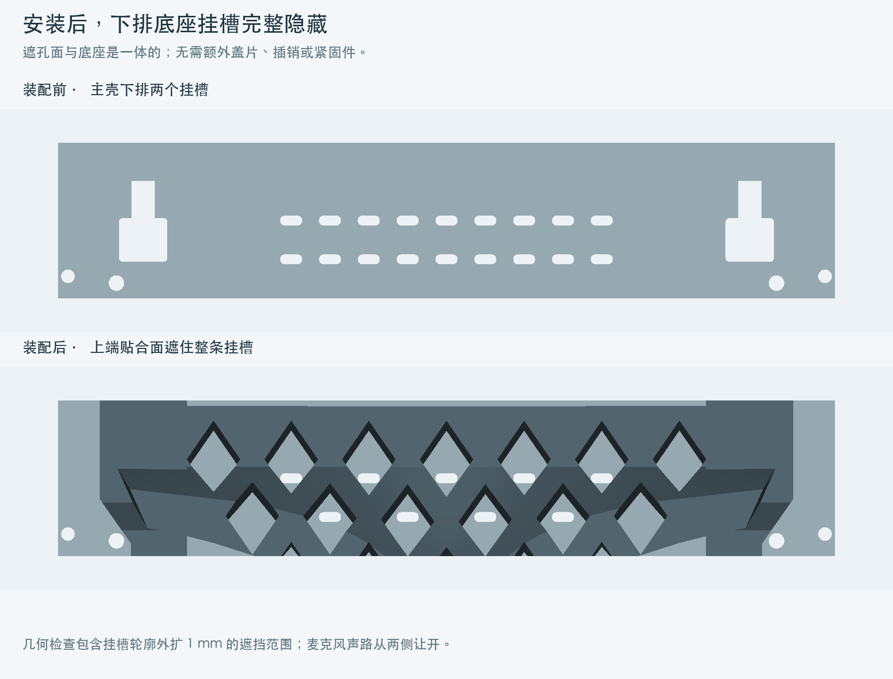

# 开发板外壳 · 打印与装配

主壳、喇叭盒、底座各是一体件。底座采用 20 个菱形镂空的立架和平整圆角底盘，二者连成一个实体，不拆件、无插榫。上端贴合面完整遮住主壳下排挂槽，无需额外盖片或独立锁扣。

当前用于审阅造型和装配关系，尚未实物打样。


## 文件与方向

| STL | 数量 | 包围尺寸 mm | 初始打印方向 |
|---|---:|---|---|
| [01_DLC_shell.stl](STL/01_DLC_shell.stl) | 1 | 171 × 106.34 × 22 | 背面贴床，屏幕口朝上 |
| [02_DLC_speaker.stl](STL/02_DLC_speaker.stl) | 1 | 145 × 54 × 36.3 | 网孔底贴床，开口朝上 |
| [03_stand.stl](STL/03_stand.stl) | 1 | 146 × 104 × 50.8 | 平整底盘贴床 |

STL 单位 mm，保持 100% 比例和初始方向，关闭支撑，不用自动摆正。STEP 使用装配坐标；`STEP/assembly.step` 为三件装配，`STEP/DLC20_adapter_tile.step` 为扩展插脚模板。


## 结构与装配

主壳边框和后盖一体，屏幕落在齐平台阶上，排线侧保持平直，不额外加宽。先斜放开关/USB 端，再放下按键端，从背面使用原四颗 M2.5 × 8 mm 螺丝固定，不使用预埋螺母。电源、开关、按键和 TF 路径保留。

相机排线先接好，从顶部居中的 22 × 4 mm 圆角口引出。喇叭线通过背面居中的 10 × 7 mm 孔，装好盒子后隐藏，不加扎带。

喇叭振膜朝格栅，从盒子的开口压入，四个支点托住塑料框，两个内部挡扣限位；框边可补薄双面胶防震，避免贴到振膜。外形覆盖 99 × 44 × 20.5 至 100 × 45 × 21.1 mm。

喇叭双插脚贴入上排宽口，再沿背面向下滑 8 mm 挂住。底座放稳，主机相对最终位置沿背面抬高 8 mm，宽口对准底座插脚，贴合后下放 8 mm 落座；也可固定主壳，将底座从下方贴入后向上滑 8 mm。

拆卸时反向提起 8 mm，再向外取下。向上提主机就是与底座分离的动作，搬动整机时同时托住底座；完全取走喇叭盒前断开电线。

底盘厚 4.5 mm，菱形孔宽 11、高 15 mm，孔顶斜边约 53.7°。两侧上端完整遮住挂槽，其他边缘按麦克风声路收进，不再额外开水滴孔。原声孔直径 3.2 mm，中心 X=±68、Y=−44.9 mm。



## 通用扩展口

上下两排采用同一尺寸的挂槽，按承重方向翻转：上排适合下挂模块，下排适合底座、托架等承托模块。左右中心距 125 mm，最终挂点 X=±62.5，上排 Y=20，下排 Y=−28；入口 10 × 9 mm、直槽宽 4.8 mm、滑动行程 8 mm。

通用窄根 4.2 × 8 mm，宽头 8 × 8 mm，最大兼容宽头 9 × 8 mm；贴合面 Z=22.2 mm，主壳背面 Z=22 mm。宽头限制向外拉脱，窄根和槽端承重。后续模块仍需匹配承重方向并避开相邻模块、线缆和麦克风声路。

## 已做检查

- 三个正式件均为有效单实体、连续封闭 STL，最低点为 Z=0。
- 78 项装配检查通过，覆盖原厂板载元件、屏幕斜放的离散位置、模块贴入和滑动、重力止挡、拉脱阻挡、喇叭尺寸、隐藏走线、TF、相机出口与完整麦克风声路。
- 两个下排挂槽轮廓外扩 1 mm 后，仍被底座完整遮挡，见 [fit_validation.json](verification/fit_validation.json)。
- 两模块通过 0.20 mm 逐层承托检查，无新生悬空区域，见 [support_free_geometry.json](verification/support_free_geometry.json)。该检查独立于切片支撑开关。
- Bambu Studio 02.08.02.61 / P1S 0.4 mm / Generic PETG / 0.20 mm / 4 圈墙 / 15% gyroid 参考切片：三件关闭支撑成功生成刀路，支撑刀路为零、无警告；输入哈希及结果见 [slice_validation.json](verification/slice_validation.json)。

主壳侧面接口和相机开口仍包含桥接；自动支撑算法可能给局部斜面添加支撑，交付方向按关闭支撑使用。当前未做实物打样，CAD 与切片不代替打印变形、配合松紧、承载或桌面触控稳定性验证。包内不附机器专用 G-code。

## 源文件

`cad/build_design.py` 生成模型，`cad/stand.py` 定义一体底座，`cad/interface.py` 定义通用接口，`cad/parameters.json` 记录当前参数。部分特征直接在 Python 源码中定义。以下命令均在仓库根目录执行，建议 Python 3.12。

```sh
python3 -m venv .venv
.venv/bin/pip install -r cad/requirements.txt
.venv/bin/python cad/build_design.py
.venv/bin/python cad/check_printability.py
```

完整板卡检查和预览需要原厂 `ESP32-P4-WIFI6-Touch-LCD-7B_3d-20251108.stp`：放入根目录，运行 `cad/analyze_board.py` 建立缓存，再运行 `cad/verify_design.py`、`cad/render_design.py`。脚本校验固定参考文件的哈希。下载包不包含原厂文件、喇叭参考图片或缓存。macOS 安装 Bambu Studio 后可运行 `cad/check_slice.py` 重做参考切片，脚本使用独立临时配置，不修改用户设置。

完整步骤见 [开发说明](../../docs/DEVELOPMENT.md)，项目约束见 [AGENTS.md](../../AGENTS.md)。本项目原创内容采用 [MIT License](../../LICENSE)，第三方资料范围见 [THIRD_PARTY_NOTICES.md](../../THIRD_PARTY_NOTICES.md)。
